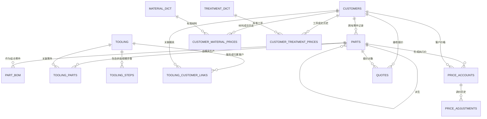

# Zephyr ERP 数据库设计（唯一权威版）

> 状态：已确认，后续数据库、ORM、迁移和 Excel 导入均以本文为唯一设计依据。
> 确认日期：2026-07-12
> 主键策略：开发阶段统一使用 `INTEGER/BIGSERIAL`，暂不迁移 UUID。
> 历史设计：仓库中其他带有 `final`、`design`、`data-model` 字样的旧文件均不得作为实现依据。

## 1. 已确认的业务事实

1. Excel 的“本厂产品编号”是模具号，不是内部零件编号。
2. Excel 的“本厂产品名称”是内部零件名称。
3. 每个合作公司作为一个独立客户记录，不建立客户母公司/子公司层级。
4. 零件记录按客户维护，同时保留内部零件号和客户件号；同一客户件号可以在不同客户下重复使用。
5. 零件处理方式属于零件记录；同一零件号的不同处理方式形成不同零件记录。
6. 零件可以通过 `parent_part_id` 表示可选的派生来源；没有派生关系的零件该字段为空。
7. 同一个内部零件可以销售给多个客户，并具有不同的客户件号、客户件名和价格。
5. 同一副模具可以关联多个客户，不能用 `tooling.customer_id` 表达全部关系。
6. 一副模具可以关联一个或多个内部零件；一个内部零件也可能经过多副非连续模。
7. “模数”和“穴数”是两个不同概念：
   - `cavity_count` 只表示“1 出 N”。
   - 非连续模的“模数”表示简易模/工程模的工序步数。
   - 连续模不得把“模数”自动解释为简易模步数。
8. Excel 是外部导入来源，不是正式数据库结构的定义者；数据必须先进入导入暂存层并通过校验。

## 2. 命名和建模原则

- 客户主表统一为 `customers`。
- 内部零件主表统一为 `parts`。
- 模具/工装主表统一为 `tooling`；不再新增或并行维护 `dies`、`tooling_molds`。
- 客户、零件和客户件号在零件记录中统一管理；`internal_part_no` 与 `customer_part_no` 是两个不同字段。
- 客户件号不得写入内部零件号字段。
- 模具号只能进入 `tooling.tooling_number`，不得写入零件编号字段。
- 零件与模具使用关系表 `tooling_parts`，不得依赖文本模具号猜测关系。
- 模具与客户使用关系表 `tooling_customer_links`，不得在模具表放单一客户外键代替多客户关系。
- 价格按“内部零件 + 客户”管理，唯一业务键为 `(part_id, customer_id)`。
- 历史价格和报价快照不可被当前字典价格覆盖。

## 3. 核心关系



## 4. 客户主数据

### 4.1 `customers`

客户是顶级业务实体。

| 字段 | 类型 | 约束 | 说明 |
|---|---|---|---|
| id | INTEGER | PK | 客户 ID |
| customer_code | VARCHAR(20) | UNIQUE, NULL | Excel“客户名称代号”中的本厂代号，如 A、AA、BG |
| name | VARCHAR(200) | NOT NULL | 客户正式名称 |
| short_name | VARCHAR(100) | NULL | 客户简称，如 ZF、IBI、ITT |
| contact_person | VARCHAR(100) | NULL | 联系人 |
| contact_phone | VARCHAR(50) | NULL | 电话 |
| contact_email | VARCHAR(100) | NULL | 邮箱 |
| address | TEXT | NULL | 地址 |
| is_active | BOOLEAN | NOT NULL DEFAULT TRUE | 是否启用 |
| created_at | TIMESTAMP | NOT NULL | 创建时间 |
| updated_at | TIMESTAMP | NOT NULL | 更新时间 |

规则：

- `customer_code` 必须以“客户名称代号”Sheet 为基础维护，不能通过截取 Sheet 名末尾字母猜测。
- `ZF`、`IBI`、`ITT` 等完整简称不得被拆成客户名和单字母代号。
- 客户已存在时，导入程序必须补充或校正 `customer_code`，不能直接跳过。

## 5. 内部零件与客户件号

### 5.1 `parts`（零件表）

`parts` 是按客户维护的零件记录。每条记录表示一个客户下的一个内部零件号、客户件号和处理方式组合。

| 字段 | 类型 | 约束 | 说明 |
|---|---|---|---|
| id | INTEGER | PK | 内部零件唯一标识 |
| customer_id | INTEGER | FK -> customers.id, NOT NULL | 所属客户；每个合作公司作为独立客户 |
| internal_part_no | VARCHAR(100) | NOT NULL | 内部零件号 |
| internal_name | VARCHAR(200) | NOT NULL | 内部零件名称 |
| customer_part_no | VARCHAR(150) | NULL | 客户件号 |
| customer_part_name | VARCHAR(200) | NULL | 客户零件名称 |
| process_type | VARCHAR(100) | NULL | 处理方式 |
| process_description | TEXT | NULL | 处理说明 |
| parent_part_id | INTEGER | FK -> parts.id, NULL | 派生来源零件；无派生关系时为空 |
| material_id | INTEGER | FK, NULL | 标准材料 |
| thickness | NUMERIC(10,3) | NULL | T，厚度 |
| width | NUMERIC(10,3) | NULL | W，宽度 |
| pitch | NUMERIC(10,3) | NULL | P，步距 |
| gross_weight | NUMERIC(12,3) | NULL | 单件毛重 |
| net_weight | NUMERIC(12,3) | NULL | 单件净重 |
| position | VARCHAR(20) | NULL | left/right/center 等 |
| status | VARCHAR(30) | NOT NULL DEFAULT 'DRAFT' | 生命周期状态 |
| drawing_path | VARCHAR(500) | NULL | 图纸路径 |
| is_deleted | BOOLEAN | NOT NULL DEFAULT FALSE | 软删除 |
| created_at | TIMESTAMP | NOT NULL | 创建时间 |
| updated_at | TIMESTAMP | NOT NULL | 更新时间 |

规则：

- `internal_part_no` 是业务可见的内部零件号，同一客户下同一版本不得重复。
- 客户件号保存于 `customer_part_no`，不得写入 `internal_part_no`。
- `process_type` 不同的零件记录视为不同可用零件记录。
- `parent_part_id` 只表示派生关系，不是每条记录都必须填写的基础零件号。
- `internal_name` 不唯一，不得仅凭名称自动合并零件。
- Excel 导入阶段可生成不可见的匹配指纹，但指纹不是业务编号。
- 推荐匹配指纹：`tooling_number + 规范化 internal_name + material + T/W/P + position`。
- 指纹冲突或技术参数不一致时进入人工复核，不得自动覆盖或合并。

### 5.2 客户件号字段

客户件号直接保存在 `parts` 表，与对应客户和内部零件记录在同一条记录中。原 `part_customer_aliases` 作为兼容历史数据的旧结构，不再作为新的目标设计。

| 字段 | 类型 | 约束 | 说明 |
|---|---|---|---|
| 字段 | 说明 |
|---|---|
| `customer_id` | 所属客户 |
| `internal_part_no` | 内部零件号 |
| `customer_part_no` | 客户件号，可为空 |
| `process_type` | 处理方式 |
| `revision` | 零件版本 |

唯一约束：

```text
UNIQUE(customer_id, internal_part_no, revision)

客户件号如不为空，建议增加唯一约束：

```text
UNIQUE(customer_id, customer_part_no, revision)
```

不同客户可以使用相同的客户件号。

### 5.3 `part_BOM`（零件组成表）

记录一个组合零件由哪些单个零件组成。安装包可以在需要时按 BOM 组合，不代表必须建立独立库存零件。

| 字段 | 类型 | 约束 | 说明 |
|---|---|---|---|
| id | INTEGER | PK | BOM ID |
| parent_part_id | INTEGER | FK -> parts.id, NOT NULL | 组合零件 |
| component_part_id | INTEGER | FK -> parts.id, NOT NULL | 组成零件 |
| quantity | NUMERIC(12,3) | NOT NULL DEFAULT 1 | 组成数量 |
| unit | VARCHAR(30) | NOT NULL DEFAULT '个' | 计量单位 |
| sequence | INTEGER | NOT NULL DEFAULT 1 | 组成顺序 |
| revision | VARCHAR(50) | NOT NULL DEFAULT 'V1' | BOM 版本 |
| is_active | BOOLEAN | NOT NULL DEFAULT TRUE | 是否启用 |
| remark | TEXT | NULL | 备注 |

约束：`quantity > 0`、`parent_part_id <> component_part_id`，以及 `UNIQUE(parent_part_id, component_part_id, revision)`。
```

同一 `part_id` 可以关联多个客户。

## 6. 模具主档、步骤和客户关系

### 6.1 `tooling`

| 字段 | 类型 | 约束 | 说明 |
|---|---|---|---|
| id | INTEGER | PK | 模具 ID |
| tooling_number | VARCHAR(100) | UNIQUE, NOT NULL | Excel“本厂产品编号” |
| tooling_name | VARCHAR(200) | NULL | 模具显示名称，可人工维护；不得替代零件内部名称 |
| mold_type | VARCHAR(50) | NOT NULL | 连续模、工程模、简易模等 |
| is_continuous | BOOLEAN | NOT NULL | 是否连续模 |
| cavity_count | INTEGER | NOT NULL DEFAULT 1 | 只表示“1 出 N” |
| process_step_count | INTEGER | NULL | 非连续模的简易模/工程模步数 |
| status | VARCHAR(30) | NOT NULL DEFAULT 'DRAFT' | 开发、可用、维修、报废等 |
| shot_count | BIGINT | NOT NULL DEFAULT 0 | 累计冲次 |
| max_shot_count | BIGINT | NULL | 设计寿命 |
| last_maintenance_at | TIMESTAMP | NULL | 最近保养时间 |
| remark | TEXT | NULL | 备注 |
| is_deleted | BOOLEAN | NOT NULL DEFAULT FALSE | 软删除 |
| created_at | TIMESTAMP | NOT NULL | 创建时间 |
| updated_at | TIMESTAMP | NOT NULL | 更新时间 |

解释规则：

- `cavity_count` 只能从“1出2、1出4”等明确数据解析。
- 非连续模的 Excel“模数”写入 `process_step_count`。
- 连续模的内部工位数如需管理，应另设 `station_count`，不得复用 `process_step_count` 或 `cavity_count`。
- 模具号包含 `M1-M14` 等步骤范围时，应解析基础模具号和步骤，不把整个范围当成多个客户零件。

### 6.2 `tooling_steps`

只用于非连续模的简易模/工程模步骤明细。

| 字段 | 类型 | 约束 | 说明 |
|---|---|---|---|
| id | INTEGER | PK | 步骤 ID |
| tooling_id | INTEGER | FK -> tooling.id, NOT NULL | 模具主档 |
| step_no | INTEGER | NOT NULL | 第几步 |
| step_code | VARCHAR(50) | NULL | M1、M2 等 |
| step_name | VARCHAR(200) | NULL | 工序名称 |
| operation_type | VARCHAR(100) | NULL | 冲孔、折弯、切边等 |
| sequence | INTEGER | NOT NULL | 顺序 |
| created_at | TIMESTAMP | NOT NULL | 创建时间 |

唯一约束：

```text
UNIQUE(tooling_id, step_no)
```

### 6.3 `tooling_parts`

模具与内部零件是多对多关系。

| 字段 | 类型 | 约束 | 说明 |
|---|---|---|---|
| id | INTEGER | PK | 关系 ID |
| tooling_id | INTEGER | FK -> tooling.id, NOT NULL | 模具 |
| part_id | INTEGER | FK -> parts.id, NOT NULL | 内部零件 |
| position | VARCHAR(20) | NULL | left/right/center 等 |
| sequence | INTEGER | NOT NULL DEFAULT 0 | 生产/工序顺序 |
| is_primary | BOOLEAN | NOT NULL DEFAULT TRUE | 是否主模具关系 |
| created_at | TIMESTAMP | NOT NULL | 创建时间 |

唯一约束：

```text
UNIQUE(tooling_id, part_id, position)
```

### 6.4 `tooling_customer_links`

同一副模具可以关联多个客户。

| 字段 | 类型 | 约束 | 说明 |
|---|---|---|---|
| id | INTEGER | PK | 关系 ID |
| tooling_id | INTEGER | FK -> tooling.id, NOT NULL | 模具 |
| customer_id | INTEGER | FK -> customers.id, NOT NULL | 客户 |
| relation_type | VARCHAR(30) | NOT NULL | owner/user/sale |
| is_owner | BOOLEAN | NOT NULL DEFAULT FALSE | 是否所有权客户 |
| valid_from | DATE | NULL | 生效日期 |
| valid_to | DATE | NULL | 失效日期 |
| remark | TEXT | NULL | 说明 |
| created_at | TIMESTAMP | NOT NULL | 创建时间 |

唯一约束：

```text
UNIQUE(tooling_id, customer_id, relation_type)
```

## 7. 报价和价格体系

### 7.1 `quotes`

报价以客户为主体，可在内部零件建立前存在。

关键字段：

- `customer_id`
- `part_id`（可空，定点或匹配后补充）
- `customer_part_no`
- `customer_part_name`
- T/W/P、材料和工序快照
- 模具费、材料费、加工费、最终价格
- 审批状态、定点状态、版本链

定点后：

1. 建立或确认 `parts`。
2. 在统一 `parts` 零件记录中建立客户件号、处理方式和版本。
3. 建立或更新 `price_accounts`。
4. 写入客户材料和工序价格历史。
5. 如已分配模具，建立 `tooling_parts` 和 `tooling_customer_links`。

### 7.2 `price_accounts`

保存某个内部零件卖给某个客户的当前执行价格。

| 字段 | 类型 | 约束 |
|---|---|---|
| id | INTEGER | PK |
| part_id | INTEGER | FK -> parts.id, NOT NULL |
| customer_id | INTEGER | FK -> customers.id, NOT NULL |
| current_price | NUMERIC(14,4) | NULL |
| base_price | NUMERIC(14,4) | NULL |
| estimated_net_weight | NUMERIC(12,3) | NULL |
| actual_net_weight | NUMERIC(12,3) | NULL |
| material_unit_price | NUMERIC(14,4) | NULL |
| scrap_price | NUMERIC(14,4) | NULL |
| reduction_pct | NUMERIC(6,3) | NULL |
| price_year | INTEGER | NULL |
| cost_deviation_flag | BOOLEAN | NOT NULL DEFAULT FALSE |
| is_active | BOOLEAN | NOT NULL DEFAULT TRUE |
| created_at | TIMESTAMP | NOT NULL |
| updated_at | TIMESTAMP | NOT NULL |

唯一约束：

```text
UNIQUE(part_id, customer_id)
```

### 7.3 `price_adjustments`

调价必须引用 `price_accounts.id`，审批通过后在同一事务更新执行价。

状态：

```text
pending -> approved
pending -> rejected
pending -> cancelled
```

必须保存旧价、新价、原因、申请人、审批人和时间戳。

### 7.4 客户材料和工序价格历史

`customer_material_prices`：

- `customer_id`
- `material_id`
- `unit_price`
- `scrap_price`
- `quote_id`
- `quoted_at`
- `created_by`

`customer_treatment_prices`：

- `customer_id`
- `treatment_id`
- `unit_price`
- `calc_mode_snapshot`
- `unit_snapshot`
- `quote_id`
- `quoted_at`
- `created_by`

两张历史表只追加，不覆盖历史；查询默认返回最近三条。

## 8. 字典表

### 8.1 `material_dict`

标准材料唯一来源。Excel 原始材质必须先规范化，再关联 `material_id`。

不允许把 T/W/P 字符串、表头“材质”或空白模板数据写入材料字段。

### 8.2 `treatment_dict`

标准工序唯一来源，包含：

- `name`
- `calc_mode`
- `default_rate`
- `unit`
- `is_active`

## 9. Excel 导入架构

### 9.1 原则

Excel 不直接写正式业务表。导入必须分两阶段：

```text
Excel -> import_batches / excel_import_rows -> 校验与人工确认 -> 正式业务表
```

### 9.2 `import_batches`

记录文件、哈希、导入时间、状态、成功/失败数量和执行人。

### 9.3 `excel_import_rows`

每一行必须保留：

- `batch_id`
- `source_sheet`
- `source_row`
- 原始 JSON
- 解析后的客户、客户件号、内部名称、模具号、模具类型、模数、材质、T/W/P、重量
- `validation_status`
- `validation_errors`
- `resolved_part_id`
- `resolved_tooling_id`
- `resolved_customer_id`

### 9.4 动态表头映射

必须按表头名称查找列，禁止使用固定列号。需支持：

- 缺少“原图产品名称2”时后续列不串位。
- PPAP、车型、吨位、备注列顺序不同。
- 两个客户产品编号列。
- 多余空列和“返回目录”列。
- 表头位于第 1、2 或其他行。

### 9.5 Excel 字段映射

| Excel 字段 | 正式目标 |
|---|---|
| 客户名称/Sheet | customers |
| 客户名称代号 | customers.customer_code |
| 原图产品编号 | parts.customer_part_no |
| 原图产品名称1+2 | parts.customer_part_name |
| 本厂产品名称 | parts.internal_name |
| 本厂产品编号 | tooling.tooling_number |
| 模具类型 | tooling.mold_type / is_continuous |
| 非连续模的模数 | tooling.process_step_count + tooling_steps |
| 1出N | tooling.cavity_count |
| 材质、T/W/P、重量 | parts 对应字段 |
| 客户与模具关系 | tooling_customer_links |
| 模具与零件关系 | tooling_parts |

### 9.6 特殊 Sheet

- “客户名称代号”：用于维护 `customers.customer_code`，不再创建重复的客户目录主表。
- “五金模具进度一览表”：进入 `tooling_development_records` 或等价的模具开发进度表，并关联 `tooling.id`；不得丢弃。

### 9.7 导入阻断规则

以下数据不得进入正式表：

- 表头、目录、汇总、合计行。
- 空客户、空客户件号且无模具号的行。
- 把规格字符串解析为材质的行。
- 非连续模“模数”被写入穴数的行。
- 客户代号冲突。
- 同一客户件号映射到多个内部零件且未经人工确认。
- 指纹相同但技术参数冲突的零件。

## 10. 状态和审计

### 10.1 零件状态

```text
DRAFT -> SAMPLING -> MASS_PRODUCTION -> OBSOLETE
```

Excel 导入的历史数据不能一律强制设为 `MASS_PRODUCTION`；无法判断时使用 `DRAFT` 或专用的 `IMPORTED_PENDING_REVIEW`。

### 10.2 模具状态

至少包含：

```text
DEVELOPING / AVAILABLE / MOUNTED / MAINTENANCE / SCRAPPED
```

### 10.3 审计要求

正式表应能追溯：

- 数据来源批次、Sheet 和行号。
- 创建人和修改人。
- 合并、拆分、重新匹配的原因。
- 客户件号、模具关系和价格的历史变化。

## 11. 当前数据库迁移方向

当前数据库不直接视为目标设计。迁移应按以下顺序进行：

1. 备份当前数据库并冻结旧 Excel 导入脚本。
2. 创建暂存表和新的关系表。
3. 清除表头、空件号和明显错列数据。
4. 使用客户名称代号 Sheet 统一客户主档和 `customer_code`。
5. 将现有客户件号从旧的 `part_customer_aliases` 映射到 `parts.customer_part_no`。
6. 将内部零件号、客户、处理方式和版本写入统一的 `parts` 零件记录；无法确认的派生关系保留为空。
7. 将模具号统一到 `tooling.tooling_number`。
8. 建立 `tooling_parts`、`tooling_steps`、`tooling_customer_links`。
9. 对齐 ORM、API 和 Alembic，收敛到单一迁移 head。
10. 通过源行覆盖率、关系完整性和字段正确率验收后，再停用旧字段和旧表。

## 12. 明确废弃的设计

以下方案不得继续实现：

- 把客户件号错误地写入 `parts.internal_part_no`。
- 每个客户 Excel 行无条件创建一个独立内部零件。
- 用 `parts.customer_id` 表达零件只能属于一个客户。
- 用 `tooling.customer_id` 或单一 `owner_customer_id` 表达模具只能关联一个客户。
- 用文本 `mold_number` 代替 `tooling_parts` 关系。
- 把“模数”统一解释为穴数。
- 把“本厂产品名称”解释为模具名称。
- 自动生成用户可见内部零件编号。
- 同时维护 `tooling`、`dies`、`tooling_molds` 三套模具主表。
- Excel 使用固定列号直接写正式表。
- 以旧版导入报告中的“100%完成”作为数据验收依据。

## 13. 文档权威性规则

本文是唯一数据库目标设计。

- `current-schema.md` 只能描述数据库现状，不能替代目标设计。
- `gap-analysis.md` 只能记录差异，不能新增设计决策。
- 各功能 `spec.md`、`plan.md`、`research.md` 可以描述实现，但不得重新定义本文实体和关系。
- 发现冲突时，以本文为准，并修改冲突文件指向本文。
