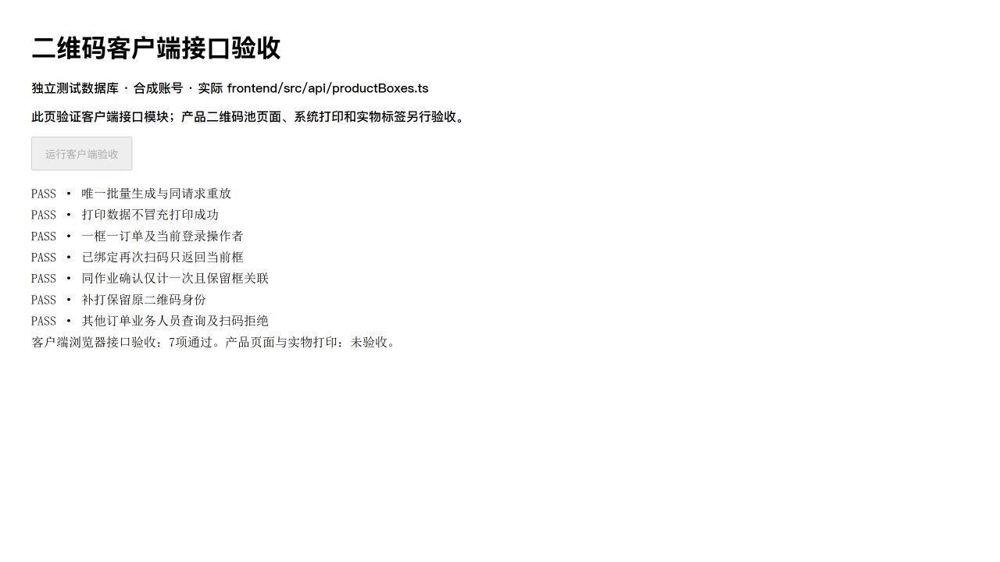

# 二维码后端池、打印与绑定：分阶段交付记录

日期：2026-10-23。范围为T009～T010、T011/T013和T015～T019；没有增加业务问答，没有部署业务库迁移或修改真实账号授权。新版任务累计17/59完成，完整US1、US2 MVP及上线验收仍未完成。

## 实现结果

| 顺序 | 阶段 | 实现结果 | 独立验收结果 |
|---|---|---|---|
| 1 | 事务和权限基础 | 权限事务锁、固定实体锁序、持久化幂等、版本冲突、安全错误；部门/等级/能力/明确订单负责人及有效生产上下文联合校验 | PASS：25项服务基础测试；撤销授权后重放仍拒绝 |
| 2 | 原材料回归修复 | 同秒身份冲突、重复分卷编号、子卷qr_uid、正有限重量、当前操作者及同事务审计、旧日期保码、母/子/同胞查询 | PASS：8项材料测试及实际HTTP回归；材料业务页面验收仍待T014 |
| 3 | 二维码池、打印、绑定API | 稳定PFB/v1、默认上限500、一次绑定、订单/路线服务端推导；PNG/作业项快照、申请人确认计数和原身份补打；9项API及严格schema | PASS：25项池/绑定测试、10项HTTP测试，包含真实并发、权限拒绝和回滚 |
| 4 | 前端接口模块 | 9项共享registry、typed bridge、领域wrapper及请求/响应类型；新bigint以字符串往返 | PASS：类型检查、API使用扫描及IAB真实浏览器7项客户端模块检查；产品工作区尚未实现 |
| 5 | 业务库边界与服务清理 | 仅独立随机测试库执行DDL/DML；诊断API/Vite停止 | 业务库只读核验PASS；发现1个缺少原始归属凭证的测试库，残留清理INCOMPLETE |

新模块为 `qr_transaction_service.py`、`qr_permission_service.py`、`product_box_service.py`、`qr_print_service.py`、`schemas/product_box.py`、`api/product_boxes.py`，均位于 `backend/app/`。API只提交一次事务，失败回滚；操作人来自实际JWT账号，AUTH_DISABLED时新QR域返回503。

原材料100kg分30+20后母卷余50，继续分10后余40，再消耗第一子卷5后该子卷余25；事务保留同一操作者和重量变化。零量、负量、NaN及超量拒绝。子卷列表/明细合并当前独立MaterialBatch子批次与旧MaterialBatchChild记录，按批号去重，不把两张表的独立ID误当同一实体。补打读取已存二维码；通用补打审计沿用QUERY及补打备注，不依赖不存在的REPRINT枚举。

已登记并挂载：池查询、生成、打印数据、打印确认、补打、绑定、扫描、能力查询、能力维护。余22项设计端点未注册为运行时active。能力维护已为本批服务提供基础，全链路审计查询/通知管理仍待T051～T055。

## 代码、数据库与API验收

在仓库根目录使用项目Python，并设置 `PYTHONPATH=backend`：

```powershell
& backend/.venv/Scripts/python.exe -m pytest backend/tests/qr/ -q --tb=short --disable-warnings --junitxml=runtime/qr-phase2-tests.xml
& backend/.venv/Scripts/python.exe -m pytest backend/tests/qr/test_pool_api.py backend/tests/qr/test_material_baseline.py -q -x --tb=short --disable-warnings --junitxml=runtime/qr-phase2-api-final.xml
& backend/.venv/Scripts/python.exe -X utf8 scripts/verification/verify_qr_phase2.py
& backend/.venv/Scripts/python.exe -X utf8 scripts/verification/verify_qr_design.py
& scripts/check_api_usage.ps1 -FailOnViolation
```

- 完整套件103项通过，0失败/跳过，耗时140.94秒：基础迁移35、事务/权限25、池/绑定25、HTTP 10、材料8。
- 最终补齐母卷明细/旧子卷兼容后，仅重验相关API/材料18项，全部通过，耗时35.46秒。两次报告按测试身份合并仍为103个独立测试，不能相加报121项。
- 旧QR辅助5项通过（材料、机台、工艺卡编码、无效输入、PNG）；旧lookup无效输入3项通过。机台/工艺卡完整业务UI不在这组辅助检查中。
- `npm run type-check`（frontend目录）退出0；API扫描0违规；设计一致性33项FR、10项SC、8故事、59任务、31端点及3条业务回答通过。
- 既有Pydantic配置及datetime.utcnow弃用警告仍存在。本批未跑生产构建，不标记T056或上线检查完成。

数据库/测试合并结果及截图摘要见 [phase2-evidence.json](./phase2-evidence.json)。测试夹具使用旧表合成前置结构和真实冻结增量迁移，不宣称完整历史迁移重放已通过。

## 真实浏览器验收

使用实际可控的 **ChatGPT in-app browser（IAB，browser id 2、tab 2）**，页面 `http://127.0.0.1:18123/acceptance`；用户本轮未指定Chrome或Edge。该会话不标记为Chrome/Edge。

诊断页从独立Vite加载实际 `frontend/src/api/productBoxes.ts`，经统一request client调用独立运行的FastAPI及随机专用PostgreSQL测试库，使用合成账号的真实JWT；没有伪造API响应。页面明确写明仅验收客户端模块。点击“运行客户端验收”后观察到7项PASS：

1. 批量生成及同键重放返回同一身份。
2. 打印数据返回A4 3×7模板，确认次数保持0。
3. 仓库绑定401订单，操作人103来自当前账号。
4. 再次扫描返回当前框，动作中没有bind。
5. 同作业不同请求键确认仍只计1次，且返回正确bound_box_id。
6. 补打生成新作业并保留原payload。
7. 另一订单业务人员池列表为0，扫码403拒绝。



当前普通前端及业务后端仍有认证绕过配置，新QR域因此尚不能作为正常业务入口使用。诊断服务仅在进程内启用认证并设置合成请求头，没有更改真实配置。**二维码池业务页面、材料页面、系统打印对话框、500项浏览器性能、两分钟绑定和实物扫码均未验收**；T012/T014/T020/T021继续待办。

## 业务库与清理边界

只读事务 `transaction_read_only=on` 核验：业务库版本仍为 `20261020_ppap`，产品框/二维码池/能力授权新表0张，旧扫码枚举标签9个，业务写入0。代码中的增量迁移尚未应用至业务库，真实账号授权未改。

本轮诊断API通过停止接口正常关闭，诊断Vite仅按匹配18124端口的进程停止；18123/18124均无监听。验收过程中另发现1个无活动连接的 `qrtmp_*` 测试库，当前OID为53638，缺少原始创建名称/OID凭证。仅凭前缀或当前OID不能证明归属，故未删除，残留清理单独记为INCOMPLETE；不宣称所有历史测试资源已清零。

## 后续任务

先完成T012旧32项QR端点映射及T014材料业务页面验收，再完成T020池/绑定/补打工作区和T021系统打印/实物扫码；生产选单、数量、流转、拆框、异常及B/C转换沿原任务继续。上线前仍须真实路线/单机目标/负责人/账号能力配置、认证整改、备份及发布验收。
