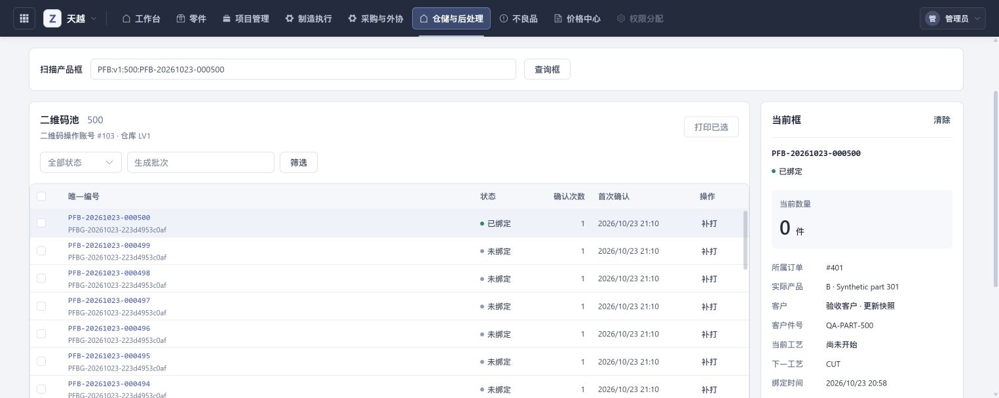
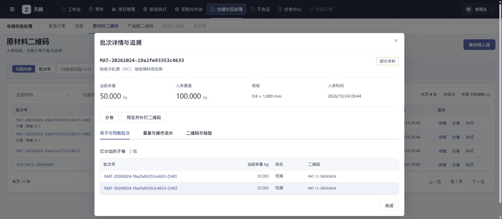

# 二维码业务工作区批次验收（2026-10-23～24）

本批新增完成T012/T014/T020，累计20/59项。T021系统/实物打印及其余生产、流转、拆框、异常、转换和上线任务保持待办。这里的“Phase 3”是验收批次编号，不表示实施计划的机台生产Phase 3已完成。

## 实现结果

- 基线32个QR端点已登记registry、领域wrapper及请求/响应类型；实际HTTP方法和query/body合同同步检查，不删除旧端点。
- `/material-qr`实现入库、IQC、分卷、母子/同胞查询、扫码定位、重量流水及原码补打。修复目录供应商异步懒加载，并以显式opt-in兼容停用历史物料。
- `/product-box-qr`实现权限驱动的池列表/筛选/分页、500项生成/跨页选择、一次订单绑定、当前框、元数据编辑、补打和A4样式。订单和产品从真实配置读取，缺配置不虚构默认业务数据。
- 新增只读订单QR配置及受版本/权限/幂等保护的元数据API；新增端点当前11/31 active。T026/T036只有相应部分实现，未把完整任务勾选。
- 编辑资料与当前框ID绑定；打开、重读、关闭或换框会清空旧表单并使旧请求失效。读取当前框和订单配置全部成功后才能保存，保存函数也再次核对已加载框ID。

实现之外的边界：全局`AUTH_DISABLED`及真实账号授权未修改，业务库未迁移。本地正常应用的产品二维码业务仍受服务端拒绝认证绕过的保护；隔离JWT验收不能当成真实账号上线完成。用户store顶部名称仍可能显示原来的“管理员”，二维码权限取真实后端响应。

## 独立验收结果

| 层次 | 证据和观察 | 结果 |
|---|---|---|
| PostgreSQL/服务/API | 完整127项通过；最终材料/API相关19项通过，其中18项重叠，合并唯一128项，失败/错误/跳过0 | PASS |
| 旧接口合同 | mounted OpenAPI合同2项；32个旧端点及4个辅助wrapper请求构造检查 | PASS |
| 前端 | `npm run type-check`及最终`npm run build`，含vue-tsc | PASS |
| 架构 | API usage扫描0违规；设计31端点/59任务/3项业务回答一致性通过 | PASS |
| 原材料真实页面 | Chrome入库100、IQC、分30+20余50、母子同胞、扫码及旧日期补打，低权限按钮禁用 | PASS |
| 产品框真实页面 | Chrome500项生成/跨页选择、预览关闭不计数、仓库绑定、已绑定重复查询、池外/跨单拒绝、元数据及补打 | PASS |
| 元数据错误恢复 | A框编辑后取消，转B框；人为阻断当前标签读取，表单空/禁用且保存禁用；恢复请求后重新读取当前B资料，可编辑保存 | PASS |
| 软件打印输出 | 500唯一码/24页A4/末页17，单框及材料旧日期PDF渲染检查无裁切 | PASS |
| 系统打印对话框 | 未操作开启/取消及现场队列选择 | NOT_RUN |
| 实物标签 | 未实体打印、未纸质扫码 | NOT_RUN |
| 整段扫码到绑定耗时 | 只观测提交至成功约1535 ms，未测量整个操作链 | NOT_MEASURED |

材料实际页面及逐项结果见 [acceptance-material.md](./acceptance-material.md)，产品池及实体打印缺口见 [acceptance-pool.md](./acceptance-pool.md)。机器证据见 [phase3-evidence.json](./phase3-evidence.json)。浏览器使用Chrome扩展browser 3，无用户指定浏览器，不声称Windows应用身份核验。验收URL为18125独立源，18124只提供仓库真实前端模块；并非诊断页替代业务页面。

两个既有远程连接超时发生在测试夹具获取连接阶段，已限制为事务前连接获取最多3次；不重放DDL、DML或测试业务。最终完整127项通过。Sass旧JS接口、Rollup注释与大chunk、旧Pydantic等警告仍存在，本批没有为消除警告扩大改动范围。

软件打印确认使用合成账号模拟操作者确认，500项确认/计数写入只证明确认流程；不代表打印机实际出纸。预览取消的0计数与之后模拟确认的500计数是同一独立数据库的不同观察时点，记录于 [phase3-product-db.json](./phase3-product-db.json)。

## 生命周期与未完成项

所有本批新建测试库均以原始名称/OID凭证清理；中断的首个UI库先核对原始OID并导出脱敏摘要，再清理。专用18124/18125服务停止；正常业务8000/5173服务保留。仅缺原始归属凭证的历史测试库仍保留，历史残留清理单列INCOMPLETE，不根据前缀猜测归属删除。

业务库只读检查版本仍为`20261020_ppap`，23张新领域表存在0，旧二维码枚举9项。没有迁移业务库、写入业务数据、关闭全局认证绕过或分配真实账号能力。US2及上线验收不因T020完成而通过。

下一实施阶段为T022起的机台上下文、订单选择、数量覆盖/完成/更正及来源分配；T021实体打印另行现场验收。生产现场MVP还需要US3/US4，不能把仓库工作区误报成完整生产系统。

